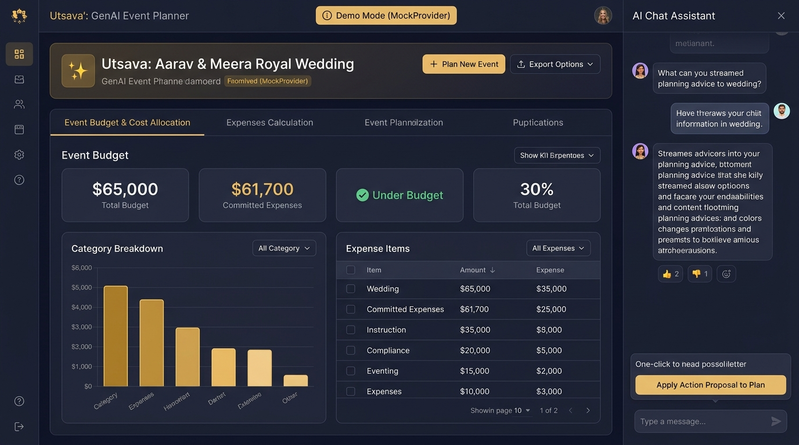

# Utsava (उत्सव) — GenAI Event Planning Assistant

[](https://github.com/satwikmishra11/Utsava/actions/workflows/ci.yml)
[](docs/ACCESSIBILITY.md)
[](LICENSE)

**Utsava** (_Sanskrit for "celebration" / "festival"_) is an intelligent, accessible, and culturally attuned event planning assistant for life's most momentous gatherings — weddings, milestone birthdays, and community festivals.

**Live Demo:** [https://utsavabysatwik.vercel.app](https://utsavabysatwik.vercel.app)  
✨ **Live GenAI Engine:** Powered by **Google Gemini 2.5 Flash** (via Google AI Studio free tier) as the primary live provider, with optional secondary Anthropic Claude support.  
🛡️ **Auditable AI Provenance & Fail-Safe Architecture:** Real-time AI status indicators, per-feature provenance badges ("AI-generated" vs. "Rule-based fallback"), zero silent mock degradation, and explainable deterministic heuristics under quota exhaustion.

---

## Preview



---

## 1. Chosen Verticals and Personas

Utsava is specifically tailored for three high-stakes celebration verticals where generic planning tools (spreadsheets, basic to-do apps) break down:

| Vertical                           | Target Persona                                                                                                                              | Core Planning Breakdown Solved                                                                                                                                                                                          |
| :--------------------------------- | :------------------------------------------------------------------------------------------------------------------------------------------ | :---------------------------------------------------------------------------------------------------------------------------------------------------------------------------------------------------------------------- |
| **Indian Weddings**                | **Couples & Multigenerational Families** managing multi-day, high-touch celebrations with diverse dietary rituals and elder accommodations. | Unifies multi-day ritual run of shows (Haldi, Mehendi, Sangeet, Mandap, Bidaai) with percentage-based category splits, elder accessibility (step-free ramp logistics), and multi-diet catering (Jain, Halal, Pure Veg). |
| **Milestone Birthdays**            | **Parents & Hosts** organizing themed, age-appropriate gatherings with sensory and safety considerations.                                   | Paces day-of entertainment schedules with strict allergen tracking (peanut-free, dairy-free), sensory quiet zones, and accessible play spaces while preventing favor/cake budget creep.                                 |
| **Community Events & Fundraisers** | **Committee Organizers & Non-Profit Leads** balancing public venue logistics, permit deadlines, and donor accountability.                   | Coordinates municipal permit lead times, noise variances, stage accessibility (ADA ramps, ASL interpretation), volunteer shifts, and sponsor fundraising targets.                                                       |

---

## 2. Approach and Decision Logic

Utsava combines **structured generative AI with pure, deterministic domain logic**. When an AI generation is requested, the system queries **Google Gemini** (`gemini-2.5-flash`) via the official `@google/genai` SDK with strict JSON schema constraints. Anthropic Claude (`claude-3-5-sonnet-latest`) is supported as an optional secondary provider.

If an external LLM call encounters a temporary outage, timeout, or free-tier rate/quota exhaustion, Utsava executes explainable, pure domain algorithms (`budgetAdvisor` and `planTimeline`) that guarantee valid plans with human-readable rationale. Crucially, fallbacks are **never concealed**: every output displays a screen-reader announced provenance badge (`Rule-based fallback (AI temporarily unavailable)`) to maintain strict user trust.

### User Context to Decision Rules

| User Context & Input                                         | Triggered Rule & Calculation                                           | Resulting System Decision & Reason                                                                                                                                    |
| :----------------------------------------------------------- | :--------------------------------------------------------------------- | :-------------------------------------------------------------------------------------------------------------------------------------------------------------------- |
| **Low Per-Guest Budget** (`totalBudget / guestCount < min`)  | Evaluated against `PER_GUEST_BUDGET_RANGES_INR[eventType]` (INR only). | **+4% Catering, -2% Decor, -2% Entertainment**<br>_Reason:_ `"Per-guest budget below reference range (₹X): +4% catering."` Preserves meal quality.                    |
| **High Per-Guest Budget** (`totalBudget / guestCount > max`) | Evaluated against `PER_GUEST_BUDGET_RANGES_INR[eventType]` (INR only). | **+2% Decor, +1% Photography, -3% Catering**<br>_Reason:_ `"Per-guest budget exceeds reference range (₹X): +3% decor/photo."` Shifts luxury surplus into aesthetics.  |
| **Large Guest List** (`guestCount >= 200`)                   | `GUEST_COUNT_THRESHOLDS.LARGE`                                         | **+2% Logistics, +2% Catering, -4% Decor**<br>_Reason:_ `"Large guest list (X): +2% logistics, +2% catering from decor."` Covers crowd transit and buffet throughput. |
| **Intimate Guest List** (`guestCount <= 50`)                 | `GUEST_COUNT_THRESHOLDS.INTIMATE`                                      | **+2% Venue, +1% Decor, -3% Logistics**<br>_Reason:_ `"Intimate guest list (X): +2% venue, +1% decor from logistics."` Prioritizes boutique ambiance.                 |
| **Multiple Dietary Needs** (`dietary.length >= 2`)           | Count of special diets (Jain, Vegan, Halal, Allergen-free).            | **+2% Catering**<br>_Reason:_ `"Multiple dietary requirements (X): +2% catering."` Offsets specialized menu preparation.                                              |
| **Accessibility Needs** (`accessibilityNeeds.length > 0`)    | Physical, mobility, auditory, or sensory accommodations.               | **+3% Logistics**<br>_Reason:_ `"Accessibility accommodations: +3% logistics."` Funds ramps, priority seating, and interpreters.                                      |
| **Short Planning Window** (`daysUntilEvent < 30`)            | `RUSH_PLANNING_DAYS_THRESHOLD`                                         | **+3% Miscellaneous Contingency**<br>_Reason:_ `"Short planning window (Xd): +3% miscellaneous contingency."` Absorbs expedited vendor premiums.                      |
| **Timeline Compression** (`maxLeadDays > daysRemaining`)     | `daysRemaining = computeDaysBetween(eventDate, today)`.                | **Lead times proportionally compressed** by `ratio = daysRemaining / maxLeadDays`. Tasks flagged with `[Compressed]` badge.                                           |
| **Overdue Milestone Detection**                              | Back-scheduled `dueDate < today`.                                      | Tasks flagged with badge `[Overdue]` in data table and list views.                                                                                                    |
| **Unpaid Vendor Commitments**                                | `sum(quotes of booked vendors) / totalBudget > 0.50`                   | **Triggers Budget Risk Warning** when unfulfilled commitments exceed 50% of the total budget.                                                                         |

---

## 3. How It Works: Request Flow & Reliability

```
User Action (Wizard, Regenerate, Chat)
  │
  ▼
[1] CSRF & HMAC-SHA256 Session Cookie Validation
  │
  ▼
[2] Sliding-Window Rate Limiting (IP & User ID)
  │
  ▼
[3] Input Scope Guardrails & Prompt Injection Sanitization
  │
  ▼
[4] Generation Cache Lookup (<1ms on identical inputs)
  │
  ▼
[5] Fail-Loud Provider Selection: Gemini (Primary) vs. Claude vs. Mock (Opt-In Only)
  │
  ▼
[6] Self-Healing Validation: Schema Validation with Corrective Retry
  │
  ▼
[7] Transparent Provenance: Tagged as 'llm', 'retry', or 'fallback' in UI and Meta
```

1. **Security & Rate Limiting**: Every mutating request checks a double-submit CSRF token, verifies an HMAC-SHA256 signed session cookie, and passes through a sliding-window rate limiter (15 req/min on AI endpoints).
2. **Input Validation & Guardrails**: Inputs are validated through strict Zod schemas. Prompt text is stripped of control delimiters and checked against event-planning scope boundaries.
3. **Generation Cache**: Context is normalized and hashed into a deterministic SHA-256 key. Repeated generations with identical parameters resolve immediately without consuming tokens.
4. **Fail-Loud Provider Resolution**:
   - `LLM_PROVIDER=auto` checks for `GEMINI_API_KEY` first, then `ANTHROPIC_API_KEY`.
   - Explicitly configured live providers fail fast with a `ConfigurationError` if their API key is missing.
   - `MockProvider` is quarantined: it cannot run unless `ALLOW_DEMO_MODE=true` is set.
5. **Self-Healing Fallback & Visible Provenance**: If an LLM call fails schema validation, a corrective retry prompt is dispatched. If the retry fails or hits upstream API quotas, pure domain heuristics execute safely. Every response returns `{ meta: { provider, model, source } }`, and the UI displays an accessible provenance badge so fallbacks are never mistaken for live AI output.

---

## 4. Assumptions and Calibration

- **Reference Per-Guest Budget Ranges (INR)**: Derived from documented benchmarks in [`src/lib/constants.ts`](src/lib/constants.ts):
  - **Indian Wedding (`wedding`)**: ₹150 – ₹250 per guest.
  - **Milestone Birthday (`birthday`)**: ₹60 – ₹120 per guest.
  - **Community Event (`community`)**: ₹30 – ₹60 per guest.
- **Operational Thresholds**: Large guest list (>=200), intimate list (<=50), rush planning window (30 days), and unpaid commitment risk warning (50% of total budget).
- **Pre-Seeded Celebrations**: Includes three production-ready datasets: Aarav & Meera's Wedding (₹65,000, 350 guests), Anya's 7th Birthday (₹3,500, 45 guests), and Oakridge Community Gala (₹20,000, 500 guests).

---

## 5. Quickstart Setup in 6 Commands

Get Utsava running locally with live Gemini AI in less than 2 minutes:

```bash
# 1. Clone the repository
git clone https://github.com/satwikmishra11/Utsava.git
cd Utsava

# 2. Install dependencies
npm install

# 3. Configure your Gemini API Key (Get a free key at https://aistudio.google.com/)
cp .env.example .env.local
# Edit .env.local and set:
# GEMINI_API_KEY=your_gemini_api_key_from_google_ai_studio

# 4. Seed database with 3 realistic celebrations
npm run seed

# 5. Start development server
npm run dev
```

Open [http://localhost:3000](http://localhost:3000) in your browser. The header badge will display **"Live AI · Gemini"**.

> [!TIP]
> **Getting a Free Gemini API Key**: Visit [Google AI Studio](https://aistudio.google.com/), sign in with any Google account, click "Create API key", and paste it into `.env.local` as `GEMINI_API_KEY`. No credit card is required.

---

## 6. Environment Variables

Utsava uses a fail-fast Zod-validated schema in [`src/lib/env.ts`](src/lib/env.ts):

| Variable            |  Required  |         Default         | Description                                                                                             |
| :------------------ | :--------: | :---------------------: | :------------------------------------------------------------------------------------------------------ |
| `NODE_ENV`          |     No     |      `development`      | Runtime environment (`development`, `test`, `production`).                                              |
| `PORT`              |     No     |         `3000`          | Local HTTP server port.                                                                                 |
| `LLM_PROVIDER`      |     No     |         `auto`          | Active LLM adapter: `auto` (prefers Gemini, falls back to Claude), `gemini`, `claude`, or `mock`.       |
| `GEMINI_API_KEY`    |    Live    |       `undefined`       | Google Gemini API key from Google AI Studio (free tier). Required when using Gemini.                    |
| `GEMINI_MODEL`      |     No     |   `gemini-2.5-flash`    | Gemini model identifier (`gemini-2.5-flash`, `gemini-1.5-pro`, etc.).                                   |
| `ANTHROPIC_API_KEY` |  Optional  |       `undefined`       | Anthropic Claude API key. Required when `LLM_PROVIDER=claude`.                                          |
| `ANTHROPIC_MODEL`   |     No     |   `claude-sonnet-5-5`   | Claude model identifier (aliased to latest Claude 3.5 Sonnet).                                          |
| `ALLOW_DEMO_MODE`   |     No     |         `false`         | Explicit permission flag to enable `MockProvider`. Required for tests and offline development.          |
| `SESSION_SECRET`    | Production | Default 32-char dev key | HMAC-SHA256 cookie signing secret (min 32 characters; strictly required and must be set in production). |

---

## 7. Demo Mode (Opt-In Offline & Test Operation)

For offline development, CI pipelines, and air-gapped evaluation where no internet access or API key is available, Utsava includes an explicit **Demo Mode**:

```bash
# Run in Demo Mode without external network dependencies
LLM_PROVIDER=mock ALLOW_DEMO_MODE=true npm run dev
```

When Demo Mode is active:

- The UI header displays **"Demo mode (offline sample data)"** with an orange indicator.
- Pure domain algorithms run deterministically without calling external APIs.
- All 3 pre-seeded celebrations remain fully interactive.
- Automated tests (`npm test`, `npm run test:e2e`) run with `ALLOW_DEMO_MODE=true` by default so CI runs stay 100% deterministic and cost zero tokens.

---

## 8. Verification Commands

Run the full verification suite locally:

```bash
# Verify code formatting
npm run format:check

# Run ESLint (including jsx-a11y and architectural boundary zones)
npm run lint

# Run strict TypeScript compiler checks
npm run typecheck

# Run Vitest unit, integration, and architecture tests with coverage
npm run test:coverage

# Run Playwright end-to-end tests and axe accessibility audits
npm run test:e2e

# Build Next.js production bundle
npm run build
```

---

## 9. Current Limitations & Roadmap

### Current Limitations

1. **Embedded SQLite Database**: Single-node SQLite (`better-sqlite3`) with automatic in-memory fallback for read-only serverless hosts.
2. **INR Per-Guest Benchmarks**: Dynamic per-guest shifting in `budgetAdvisor` is calibrated for INR; other currencies use vertical baseline splits.
3. **Single-Client Optimistic Sync**: State syncs via debounced autosave; concurrent multi-device co-editing does not yet use CRDTs.
4. **Free Tier Quotas**: Google AI Studio free tier enforces 15 requests per minute. When exceeded, Utsava automatically triggers its safe rule-based fallback and displays provenance chips without failing requests.

### Roadmap

1. **Multi-Currency Parity**: Add calibrated reference ranges for USD, EUR, GBP, and AED.
2. **Real-Time Collaboration**: Support live co-planning via WebSockets or Yjs.
3. **Automated Document Parsing**: Support vendor quote parsing from PDF invoices via Gemini Vision.

---

## 10. Documentation Index

- [**Architecture Guide**](docs/ARCHITECTURE.md): Module responsibility table, request flow, and architectural decisions.
- [**Testing Guide**](docs/TESTING.md): Test pyramid overview, mocking principles, and execution instructions.
- [**Contributing Guide**](CONTRIBUTING.md): Engineering standards, pull request checklist, and code rules.
- [**Standards Verification Guide**](docs/JUDGING_CRITERIA.md): Objective mapping of code quality, security, efficiency, testing, and accessibility.
- [**Architecture Decisions Log (ADRs)**](docs/DECISIONS.md): ADR 001 through ADR 018 detailing design trade-offs.
- [**Security Architecture**](docs/SECURITY.md): Threat model, prompt injection defense, and IDOR prevention.
- [**Accessibility Report**](docs/ACCESSIBILITY.md): WCAG 2.2 AA audit matrix and screen reader verification.
- [**Performance Report**](docs/PERFORMANCE.md): Bundle size breakdown and mobile performance optimizations.

---

## License

Released under the [MIT License](LICENSE). Built for life's most cherished gatherings.
