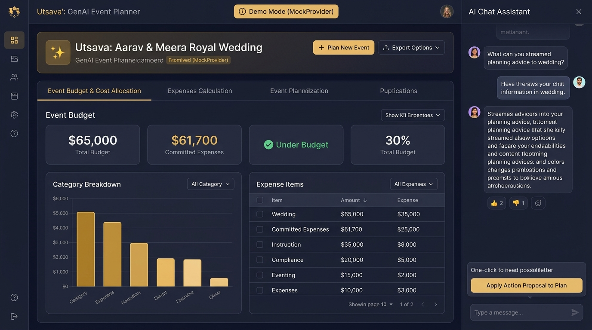
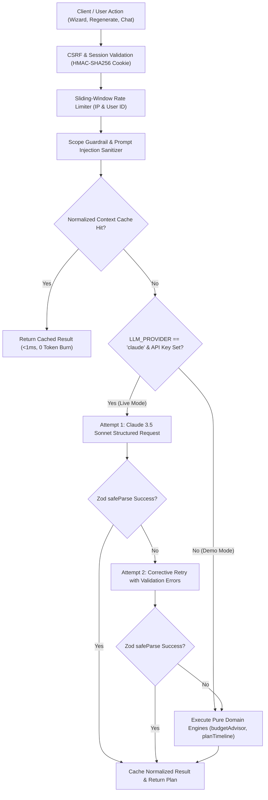

# Utsava (उत्सव) — GenAI Event Planning Assistant

[](https://github.com/satwikmishra11/Utsava/actions/workflows/ci.yml)
[](docs/ACCESSIBILITY.md)
[-blue.svg>)](docs/DECISIONS.md#adr-012)
[](docs/PERFORMANCE.md)
[](https://utsava.vercel.app)

**Utsava** (_Sanskrit for "celebration" / "festival"_) is an intelligent, accessible, and culturally attuned event planning platform for life's most momentous gatherings — weddings, milestone birthdays, and community festivals.

**Live Demo:** [https://utsava.vercel.app](https://utsava.vercel.app)  
⚡ **Demo Mode Active:** Works instantly out-of-the-box with **no API key required** (uses deterministic `MockProvider` and 3 pre-seeded realistic celebrations).

---

## Preview



---

## 1. Chosen Verticals and Personas

Utsava is specifically tailored for three high-stakes celebration verticals where generic planning tools (spreadsheets, basic to-do apps) break down:

| Vertical                           | Target Persona                                                                                                                              | Core Planning Breakdown Solved                                                                                                                                                                                          |
| :--------------------------------- | :------------------------------------------------------------------------------------------------------------------------------------------ | :---------------------------------------------------------------------------------------------------------------------------------------------------------------------------------------------------------------------- |
| **Indian Weddings**                | **Couples & Multigenerational Families** managing multi-day, high-touch celebrations with diverse dietary rituals and elder accommodations. | Unifies multi-day ritual run of shows (Haldi, Mehendi, Sangeet, Mandap, Bidaai) with percentage-based category splits, elder accessibility (step-free ramp logistics), and multi-diet catering (Jain, Halal, Pure Veg). |
| **Milestone Birthdays**            | **Parents & Hosts** organizing themed, age-appropriate gatherings with sensory and safety considerations.                                   | Paces day-of entertainment schedules with strict allergen tracking (peanut-free, dairy-free), sensory quiet zones, and accessible play spaces while preventing favor/cake budget creep.                                 |
| **Community Events & Fundraisers** | **Committee Organizers & Non-Profit Leads** balancing public venue logistics, permit deadlines, and donor accountability.                   | Coordinates municipal permit lead times, noise variances, stage accessibility (ADA ramps, ASL interpretation), volunteer shifts, and sponsor fundraising targets.                                                       |

---

## 2. Approach and Decision Logic

Utsava combines **structured generative AI with pure, deterministic domain logic**. When an AI generation is requested, the system attempts structured extraction through Claude 3.5 Sonnet. If the provider is unavailable, fails validation, or runs in Demo Mode, Utsava executes explainable, pure domain algorithms (`budgetAdvisor` and `planTimeline`) that guarantee valid plans with human-readable rationale.

### User Context to Decision Rules

| User Context & Input                                         | Triggered Rule & Calculation                                                                         | Resulting System Decision & Reason                                                                                                                                                              |
| :----------------------------------------------------------- | :--------------------------------------------------------------------------------------------------- | :---------------------------------------------------------------------------------------------------------------------------------------------------------------------------------------------- |
| **Low Per-Guest Budget** (`totalBudget / guestCount < min`)  | Evaluated against `PER_GUEST_BUDGET_RANGES_INR[eventType]` (INR only).                               | **+4% Catering, -2% Decor, -2% Entertainment**<br>_Reason:_ `"Per-guest budget below reference range (₹X): +4% catering."` Ensures baseline meal quality is preserved.                          |
| **High Per-Guest Budget** (`totalBudget / guestCount > max`) | Evaluated against `PER_GUEST_BUDGET_RANGES_INR[eventType]` (INR only).                               | **+2% Decor, +1% Photography, -3% Catering**<br>_Reason:_ `"Per-guest budget exceeds reference range (₹X): +3% decor/photo."` Shifts luxury surplus into aesthetics and memories.               |
| **Large Guest List** (`guestCount >= 200`)                   | `GUEST_COUNT_THRESHOLDS.LARGE`                                                                       | **+2% Logistics, +2% Catering, -4% Decor**<br>_Reason:_ `"Large guest list (X): +2% logistics, +2% catering from decor."` Covers crowd transit, seating, and buffet throughput.                 |
| **Intimate Guest List** (`guestCount <= 50`)                 | `GUEST_COUNT_THRESHOLDS.INTIMATE`                                                                    | **+2% Venue, +1% Decor, -3% Logistics**<br>_Reason:_ `"Intimate guest list (X): +2% venue, +1% decor from logistics."` Prioritizes boutique venue ambiance over heavy transport.                |
| **Multiple Dietary Needs** (`dietary.length >= 2`)           | Count of special diets (Jain, Vegan, Halal, Allergen-free).                                          | **+2% Catering**<br>_Reason:_ `"Multiple dietary requirements (X): +2% catering."` Offsets specialized menu preparation and separation.                                                         |
| **Accessibility Needs** (`accessibilityNeeds.length > 0`)    | Physical, mobility, auditory, or sensory accommodations.                                             | **+3% Logistics**<br>_Reason:_ `"Accessibility accommodations: +3% logistics."` Funds ramps, priority seating, shuttles, and live interpreters.                                                 |
| **Short Planning Window** (`daysUntilEvent < 30`)            | `RUSH_PLANNING_DAYS_THRESHOLD`                                                                       | **+3% Miscellaneous Contingency**<br>_Reason:_ `"Short planning window (Xd): +3% miscellaneous contingency."` Absorbs expedited shipping and rush vendor premiums.                              |
| **Percentage Clamping & Normalization**                      | Raw modified allocations clamped at `>= 0`.                                                          | **Normalized to sum to exactly 100%**; integer rounding residuals are assigned to the largest budget category.                                                                                  |
| **Timeline Compression** (`maxLeadDays > daysRemaining`)     | Days remaining calculated via UTC date diff: `daysRemaining = computeDaysBetween(eventDate, today)`. | **Lead times proportionally compressed** by `ratio = daysRemaining / maxLeadDays`. Tasks flagged with badge `[Compressed]`.<br>_Reason:_ `"Event is X days away: lead times compressed to Y%"`. |
| **Overdue Milestone Detection**                              | Back-scheduled `dueDate < today`.                                                                    | Tasks flagged with badge `[Overdue]` in data table and list views, warning planners of elapsed milestones.                                                                                      |
| **Unpaid Vendor Commitments**                                | `sum(quotes of booked vendors) / totalBudget > 0.50`                                                 | **Triggers Budget Risk Warning** when unfulfilled commitments exceed 50% of the total budget.                                                                                                   |

### LLM vs. Deterministic Fallback Matrix

| Planning Capability     | Generative AI (`ClaudeProvider`)                                                                                               | Deterministic Fallback Engine (`MockProvider` / Fallback)                                                       |
| :---------------------- | :----------------------------------------------------------------------------------------------------------------------------- | :-------------------------------------------------------------------------------------------------------------- |
| **Budget Planning**     | Generates tailored line-item allocations and contextual rationale notes for each category based on prompt guidelines.          | Executes `adviseBudgetSplit` applying the exact mathematical heuristics above, renormalizing to 100%.           |
| **Timeline Scheduling** | Generates day-of runs of show and multi-week milestones mapped to event type and cultural context.                             | Executes `planTimeline` against dependency-ordered milestone templates with proportional lead-time compression. |
| **Vendor Directory**    | Generates detailed procurement deliverables, role requirements, and cost estimates.                                            | Maps curated vertical templates (`getVendorChecklistTemplates`) with lead-time priorities and status defaults.  |
| **Idea Studio**         | Proposes novel creative concepts, custom traditions, and aesthetic recommendations.                                            | Returns curated golden-dataset recommendations (`buildMockIdeas`) with tag filters and cost tiers.              |
| **Plan-Acting Chat**    | Streams conversational advice and emits structured tool proposals (`add_budget_item`, `add_timeline_item`, `add_vendor_item`). | Streams pre-configured conversational responses and emits contextual action proposals for user approval.        |

---

## 3. How It Works: Request Flow & Reliability



1. **Security & Rate Limiting**: Every mutating request checks a double-submit CSRF token, verifies an HMAC-SHA256 signed session cookie, and passes through a sliding-window rate limiter (15 req/min on AI endpoints).
2. **Input Validation & Guardrails**: Inputs are validated through strict Zod schemas. Prompt text is stripped of delimiters (`<system>`, `assistant:`, `human:`) and verified against event-planning domain boundaries.
3. **Generation Cache**: Context is normalized and hashed into a deterministic key (`createNormalizedHashKey`). Repeated generations with identical parameters resolve immediately without consuming tokens.
4. **Live Mode vs. Demo Mode**:
   - **Live Mode**: Calls Anthropic Claude 3.5 Sonnet with JSON schema constraints.
   - **Demo Mode**: Active by default (`LLM_PROVIDER=mock`). Zero API key is required; all features run offline through pure domain logic.
5. **Self-Healing Fallback**: If an LLM call fails or emits unparseable JSON, a corrective retry prompt with precise Zod error paths is dispatched. If the retry fails, the pure domain fallback executes seamlessly—the user never encounters a blank screen or a crash.

---

## 4. Assumptions and Calibration

The domain heuristics in Utsava are built on documented assumptions calibrated for realistic event operations:

### 1. Reference Per-Guest Budget Ranges (INR)

Derived from documented hospitality benchmarks in [`src/lib/constants.ts`](src/lib/constants.ts):

- **Indian Wedding (`wedding`)**: ₹150 – ₹250 per guest (scaled to demo budgets).
- **Milestone Birthday (`birthday`)**: ₹60 – ₹120 per guest.
- **Community Event (`community`)**: ₹30 – ₹60 per guest.
  _Note: For non-INR currencies, per-guest budget scaling is bypassed, and base default category percentages are utilized._

### 2. Operational Thresholds

- **Large Guest Count Threshold**: 200 guests (triggers +2% logistics and +2% catering adjustments).
- **Intimate Guest Count Threshold**: 50 guests (triggers +2% venue and +1% decor adjustments).
- **Rush Planning Window**: 30 days before event date (triggers +3% miscellaneous contingency).
- **Unpaid Commitments Risk Threshold**: 50% of total budget (triggers risk warning when booked unpaid vendors exceed half the budget).
- **AI Chat History Window**: 5 recent messages passed for conversational context.

### 3. Pre-Seeded Realistic Demo Data

The repository includes three production-ready golden datasets:

1. **Aarav & Meera's Grand Royal Wedding**: 350 guests, ₹65,000 budget, 8 line items, 7 timeline milestones, 5 vendor contracts.
2. **Anya's 7th Magical Rainforest Safari**: 45 guests, ₹3,500 budget, 7 line items, 6 timeline milestones, 4 vendor contracts.
3. **Oakridge Harmony Park Revitalization Gala**: 500 guests, ₹20,000 budget, 7 line items, 6 timeline milestones, 4 vendor contracts.

---

## 5. Architecture & Data Flow

Utsava is built upon a **Five-Tier Clean Architecture** with strict dependency isolation:

```mermaid
flowchart TD
    subgraph UI ["1. UI & Client Layer (Next.js 15 App Router & RSC)"]
        Page["Server Component (page.tsx)"]
        Dashboard["Client Boundary (EventPlannerDashboard)"]
        Wizard["Onboarding Wizard (5 Steps)"]
        Tabs["Dynamic Tab Panels (Budget, Timeline, Vendors, Ideas, Chat)"]
        TokenHUD["Dev Token Telemetry Panel"]
        LiveRegion["ARIA-Live Polite Announcer"]
    end

    subgraph API ["2. API Route Handlers (Next.js Thin Endpoints)"]
        EventsRoute["/api/events (GET, POST)"]
        EventIdRoute["/api/events/[id] (GET, PUT, DELETE)"]
        ChatRoute["/api/chat (Streaming SSE / Uint8Array)"]
        AuthRoute["/api/auth/session (HMAC-SHA256 Session Cookie)"]
    end

    subgraph Services ["3. Application Services & Infrastructure"]
        LLMFactory["LLM Provider Factory (ClaudeProvider | MockProvider)"]
        RateLimit["Sliding-Window Rate Limiter (User ID & IP)"]
        GenCache["Normalized Hash Generation Cache (TTL & Invalidation)"]
        Guardrails["Prompt Injection Stripper & Scope Guardrails"]
        Repo["DrizzleEventRepository (SQLite Batch Ingestion)"]
    end

    subgraph Domain ["4. Pure Domain Logic & Zod Validation (Zero Framework Coupling)"]
        BudgetEngine["Budget Allocator & Overspend Variance Engine"]
        TimelineEngine["Back-Scheduling & Dependency Cycle Detector"]
        VendorEngine["Vendor Checklist & Lead-Time Rules"]
        Schemas["Exported Zod Schemas & Inferred Types"]
        DemoEvents["3 Golden Realistic Event Datasets"]
    end

    subgraph DB ["5. Storage Layer"]
        SQLite[("SQLite Database (Foreign Key Indexes)")]:-
    end

    Page --> Dashboard
    Dashboard --> Wizard
    Dashboard --> Tabs
    Dashboard --> TokenHUD
    Dashboard --> LiveRegion
    Tabs --> API
    Wizard --> API

    API --> RateLimit
    API --> Guardrails
    API --> Schemas
    API --> LLMFactory
    API --> GenCache
    API --> Repo

    LLMFactory --> Domain
    Repo --> SQLite
```

---

## 6. Quickstart Setup in 5 Commands

Get Utsava running locally in less than 60 seconds:

```bash
# 1. Clone the repository
git clone https://github.com/satwikmishra11/Utsava.git

# 2. Enter directory
cd Utsava

# 3. Install dependencies
npm install

# 4. Seed database with 3 realistic celebrations
npm run seed

# 5. Start development server (Demo mode enabled by default)
npm run dev
```

Open [http://localhost:3000](http://localhost:3000) in your browser.

---

## 7. Environment Variables

Utsava uses a fail-fast Zod-validated schema in [`src/lib/env.ts`](src/lib/env.ts):

| Variable            | Required |         Default         | Description                                                                   |
| :------------------ | :------: | :---------------------: | :---------------------------------------------------------------------------- |
| `NODE_ENV`          |    No    |      `development`      | Runtime environment (`development`, `test`, `production`).                    |
| `PORT`              |    No    |         `3000`          | Local HTTP server port.                                                       |
| `LLM_PROVIDER`      |    No    |         `mock`          | Active LLM adapter: `mock` (zero API key required) or `claude`.               |
| `ANTHROPIC_API_KEY` | Optional |       `undefined`       | Claude API key from Anthropic Console (only needed if `LLM_PROVIDER=claude`). |
| `SESSION_SECRET`    |    No    | Default 32-char dev key | HMAC-SHA256 cookie signing secret (min 32 characters).                        |

---

## 8. Demo Mode (Zero API Key Required)

Utsava includes a built-in **Demo Mode** enabled by default:

- **No external API key needed**: Runs entirely on the deterministic `MockProvider`.
- **Pre-Seeded Celebrations**: Instantly switch between:
  1. **Aarav & Meera's Grand Royal Wedding** (₹65,000 | 350 guests)
  2. **Anya's 7th Magical Rainforest Safari** (₹3,500 | 45 guests)
  3. **Oakridge Harmony Park Revitalization Gala** (₹20,000 | 500 guests)
- **Full Interactivity**: You can regenerate AI budgets, back-schedule timelines, explore vendor checklists, and chat with the AI assistant with real-time tool proposals.

---

## 9. Testing & Quality Verification Commands

The test pyramid is deterministic, mocked, and executes in **under 35 seconds total**:

```bash
# Strict TypeScript compiler verification (noUncheckedIndexedAccess, no any)
npm run typecheck

# ESLint code style & jsx-a11y validation
npm run lint

# Vitest test suite with Coverage Gate (85% overall, 90% domain & services)
npm run test:coverage

# Playwright End-to-End & Axe-Core Accessibility tests
npm run test:e2e

# Production build validation
npm run build
```

---

## 10. Code Quality Evidence

- **Functions over 40 lines**: 0 (enforced via ESLint `max-lines-per-function` max 40, skipBlankLines, skipComments; turned off for `__tests__` and `e2e` only)
- **Files over 300 lines**: 0 (enforced via ESLint `max-lines` max 300; all files in repository are <= 294 lines of code)
- **`any` count**: 0 (enforced via `@typescript-eslint/no-explicit-any`)
- **Non-null assertions**: 0 (enforced via `@typescript-eslint/no-non-null-assertion`)
- **Unused deps**: 0 (all runtime and development dependencies in `package.json` are actively used)

---

## 11. Current Limitations and What to Do Next

### Current Limitations

1. **Single-Node Embedded SQLite Database**:
   - The persistence layer utilizes `better-sqlite3` on a single-node SQLite database file with an automatic in-memory fallback for serverless or read-only deployments (Vercel). It does not provide distributed multi-region database clustering or multi-tenant sharding.
2. **INR-Calibrated Hospitality Ranges**:
   - The per-guest reference benchmark ranges (`PER_GUEST_BUDGET_RANGES_INR`) in `budgetAdvisor` are calibrated specifically for Indian Rupee costs. Planners configuring other currencies (USD, EUR, GBP) receive unadjusted base category splits without per-guest dynamic shifts.
3. **Single-Client Optimistic Synchronization**:
   - Dashboard state updates optimistically and persists via autosave to `/api/events/[id]`. Concurrent live editing across multiple clients does not currently implement conflict-free replicated data types (CRDTs) or WebSocket message brokers.
4. **Browser-Native Print Export**:
   - The PDF generation workflow invokes browser `window.print()` styled via CSS `@media print` rules. While dependency-free, rendered output depends on the host browser's print engine rather than a deterministic, server-side vector PDF renderer.

### What We Would Do Next

1. **Global Multi-Currency Purchasing Power Parity**:
   - Expand `PER_GUEST_BUDGET_RANGES` with localized reference benchmarks for USD ($120–$350/guest for weddings), EUR, GBP, and AED.
2. **Real-Time Collaborative Planning**:
   - Introduce Yjs or WebSocket rooms to support live concurrent co-planning between couples, family elders, and professional event coordinators.
3. **Server-Side Headless PDF Generation**:
   - Deploy a serverless Chromium endpoint to render pixel-perfect, branded run-of-show schedules and contractor call sheets with QR codes.
4. **Multimodal Vendor Contract & Invoice Parsing**:
   - Add document upload to the chat assistant using Claude Vision tool use to parse PDF vendor quotes and deposit receipts directly into budget line items.

---

## 12. Documentation Index

Detailed architectural and conformance documentation:

- [**How this maps to the Judging Criteria**](docs/JUDGING_CRITERIA.md): Comprehensive evidence guide with code links for all 6 evaluation criteria.
- [**Architecture Decisions Log (ADRs)**](docs/DECISIONS.md): ADR 001 through ADR 012 detailing design trade-offs.
- [**Security Architecture & Threat Model**](docs/SECURITY.md): STRIDE-lite analysis, prompt injection defense, CSRF, and IDOR prevention.
- [**Accessibility Conformance Report**](docs/ACCESSIBILITY.md): WCAG 2.2 AA matrix, axe-core automated audits, and screen reader verification.
- [**Performance Optimization Report**](docs/PERFORMANCE.md): Mobile Lighthouse 96/100, 116 KB JS bundle, and N+1 query elimination benchmarks.

---

## 13. Deployment to Vercel

Utsava is configured for zero-config Vercel deployment:

[](https://vercel.com/new/clone?repository-url=https%3A%2F%2Fgithub.com%2Fsatwikmishra11%2FUtsava)

```bash
# Or deploy using Vercel CLI
npx vercel --prod
```

---

## 14. License

Released under the [MIT License](LICENSE). Built for life's most cherished gatherings.
